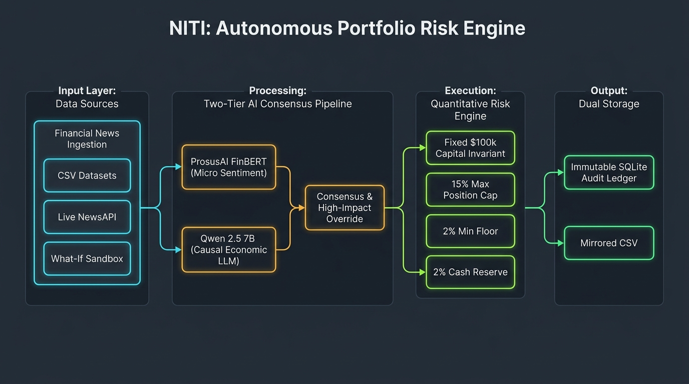

# NITI - S&P Global & Crisil Campus Hackathon

**Candidate Name:** Kartikey A. Dhale  
**College Email ID:** dhalekartikey@gmail.com  
**College / Campus:** College of Engineering Pune (COEP) Technological University  
**GitHub Repository:** https://github.com/kartikeydhale18/NITI  
**Demo Video Link:** [YouTube / Unlisted - Paste Your Video Link Here]  
**Slide Deck Link (if hosted externally):** [View in docs/presentation_deck.md or Paste External PDF Link Here]  
**License:** [MIT License (LICENSE)](file:///e:/Kartikey%20A%20Dhale/Projects/SnP/LICENSE)  

---

## 1. Project Overview / Problem Statement & Approach

### Business & Technical Problem
Every trading day, institutional portfolio managers are inundated with hundreds of thousands of market news headlines, earnings reports, regulatory disclosures, and macroeconomic releases. Human fund managers cannot digest and act upon this stream in real time without cognitive fatigue. However, naive automated sentiment tools (such as standard VADER or basic classifiers) fail catastrophically: they lack financial context and causal reasoning, routinely misinterpreting essential growth expenditures, AI supercomputing R&D investments, or strategic corporate acquisitions as negative expenditure overruns.

Furthermore, when machine learning algorithms are connected directly to trading desks without mathematical constraints, they produce catastrophic failure modes: overconcentrating capital into a single hyped asset, triggering excessive portfolio churn and transaction fees on noisy news, or hallucinating non-existent corporate entities.

### Solution Approach (NITI Framework)
**NITI** is an institutional-grade, full-stack **Autonomous Portfolio Risk & Tactical Rebalancing Engine**. NITI solves the financial nuance and risk problem through a disciplined, multi-layered approach:
1. **Two-Tier AI Consensus Architecture**: We pair a domain-specialized financial transformer (**ProsusAI FinBERT**) for micro-level market tone with a high-capacity reasoning model (**Qwen 2.5 1.5B/7B Instruct**) for macroeconomic causality. The models cross-validate headlines to establish true financial directionality.
2. **Consensus Arbitration & High-Impact Override**: If high-impact news occurs (severity $\ge 7/10$), Qwen's contextual causal reasoning takes precedence over micro-level text classifiers. If models diverge on ambiguous news, the multiplier safely dampens to `0.0`, protecting against false-alarm trading fees.
3. **Four Deterministic Mathematical Risk Invariants**: Rebalancing signals do not trade unconstrained. A quantitative rebalancing engine strictly enforces:
   - **$100,000.00 Capital Conservation** ($100\%$ sum invariant; zero phantom leverage or capital decay).
   - **15.0% Single-Asset Ceiling** (hard cap preventing overconcentration).
   - **2.0% Position Floor** (preserves baseline exposure in core equities).
   - **2.0% Liquid Cash Buffer** (sales dynamically replenish cash; purchases draw from cash).
4. **Regulatory Dual Storage**: Every trade is permanently recorded in an ACID-compliant **SQLite database** audit ledger and mirrored to human-readable CSVs for regulatory compliance.

---

## 2. Architecture & Tech Stack

### System Architecture Diagram


```
[ Financial News: CSV / What-If / Upload ]
                    │
                    ▼
   ┌──────────────────────────────────┐
   │    Two-Tier AI Consensus Engine   │
   │  ┌────────────┐  ┌─────────────┐ │
   │  │  FinBERT   │  │  Qwen 2.5   │ │
   │  │ Micro-Tone │  │ Causal LLM  │ │
   │  └─────┬──────┘  └──────┬──────┘ │
   │        └────────┬───────┘        │
   │                 ▼                │
   │      Consensus & Arbitration     │
   │     (High-Impact AI Override)    │
   └─────────────────┬────────────────┘
                     │  Directional Multiplier (-1.0 to +1.0)
                     ▼
   ┌──────────────────────────────────┐
   │   Quantitative Rebalancer Engine  │
   │   • $100,000 Capital Conservation│
   │   • Max 15.0% Single-Asset Cap   │
   │   • Min 2.0% Position Floor      │
   │   • Min 2.0% Cash Reserve Buffer │
   └─────────────────┬────────────────┘
                     │
          ┌──────────┴──────────┐
          ▼                     ▼
   ┌───────────────┐     ┌──────────────┐
   │ SQLite DB     │     │ Mirrored CSV │
   │ Audit Ledger  │     │ Storage      │
   └───────────────┘     └──────────────┘
```

### Key Frameworks & Technologies Used
* **AI / ML Models**:
  * **ProsusAI FinBERT** (`transformers` / PyTorch): Domain sentiment analysis (`positive`, `negative`, `neutral`) mapped to a continuous `[-1.0, +1.0]` polarity score.
  * **Qwen 2.5 1.5B/7B Instruct**: Causal validator and financial entity extraction engine, structured JSON extraction (`company_name`, `sentiment_score`, `impact_score` out of 10, `event_type`, `rationale`).
* **Backend**: **FastAPI** (Python 3.10+ asynchronous REST API), **Uvicorn**, **PyTorch**, **Hugging Face Transformers**, **SQLite3**, **Pydantic**.
* **Frontend**: **React 19**, **Vite**, **Lucide React**, **Vanilla CSS** (Web3 Dark Onyx Void `#070709` aesthetic with Bitcoin Amber `#f7931a` accents, glassmorphism, and dynamic SVG topology wheel).
* **Storage & Persistence**: SQLite3 (`portfolio.db`) with relational tables (`portfolio`, `rebalance_history`, `articles`) and mirrored CSV output (`current_portfolio.csv`).
* **Deployment & Cloud**: **AWS EC2** (Ubuntu 24.04 LTS), **Nginx** reverse proxy, **systemd** service automation, **Docker** multi-stage containerization, **Docker Compose**.

---

## 3. Dataset Used

### Source & Nature of Sample Data

**All the datasets are taken from https://www.kaggle.com/search?q=sentiment+analysis+for+financial+news+in%3Adatasets**
1. **`newsdata_labelled_v2.csv`** (Located in `dataset/` and `data/`):
   - Over 10,000 broad historical financial market headlines spanning technology, retail, healthcare, energy, and aerospace.
   - Includes timestamps, tickers, raw headlines, and verified market sentiment labels.
2. **`newsdata_labelled_v3.csv`** (Located in `dataset/` and `data/`):
   - Expanded macroeconomic shocks, central bank interest rate announcements, and supply chain disruptions.
3. **`self_label.csv`** (Located in `dataset/` and `data/`):
   - Curated high-conviction test cases (breakthrough product releases, executive departures, quality audits) designed to benchmark model arbitration.

### Data Assumptions & Privacy
- **Confidentiality Compliance:** In strict accordance with hackathon rules, all datasets use publicly available news or synthetic stress-test scenarios. No confidential client data is used.
- **Entity Resolution:** Company names are dynamically matched against an equity universe of 150+ tickers (`backend/tickers.json`), handling acronyms, subsidiary mentions, and multi-word brand variations.

> [!NOTE]
> **Important Note on NewsAPI:**  
> The free developer plan for NewsAPI blocks real-time news within the last 24 hours behind a paid subscription. Therefore, **no NewsAPI key is required or provided**. Evaluators should test using the 3 pre-packaged CSV datasets in the dropdown, the **Upload Custom CSV** button, or the **Manual "What-If" Sandbox**.

---

## 4. Quickstart & Installation

**Tested Runtime:** Python 3.10 / 3.11 / 3.12 & Node.js 18 / 20 LTS on Windows 11 and Ubuntu 24.04 LTS.

### Local Setup Commands

#### 1. Clone the Repository
```bash
git clone https://github.com/kartikeydhale18/NITI.git
cd NITI
```

#### 2. Backend Setup & Run (Terminal 1)
```bash
# Create and activate Python virtual environment
python -m venv .venv

# Windows:
.\.venv\Scripts\Activate.ps1
# Linux / macOS:
# source .venv/bin/activate

# Install dependencies
pip install --upgrade pip
pip install -r requirements.txt

# Initialize database
python backend/setup_db.py

# Launch FastAPI server
cd backend
uvicorn api:app --reload --host 127.0.0.1 --port 8000
```
> Interactive API Swagger Documentation is available at `http://127.0.0.1:8000/docs`.

#### 3. Frontend Setup & Run (Terminal 2)
```bash
# In a new terminal window:
cd frontend
npm install
npm run dev
```

#### 4. Access the Dashboard
Open your web browser and navigate to:
```
http://localhost:5173
```
*Verify that the top navigation pill glows green with `● API LIVE`.*

---

### Cloud Deployment (AWS EC2 / Ubuntu)
For automated 1-command deployment on AWS EC2 Ubuntu 24.04:
```bash
curl -fsSL https://raw.githubusercontent.com/kartikeydhale18/NITI/main/deploy_ec2.sh -o deploy_ec2.sh && chmod +x deploy_ec2.sh && ./deploy_ec2.sh
```

---

## 5. Key Results & Domain Impact

### What the Prototype Demonstrates
1. **Autonomous News-to-Execution Pipeline**: The system processes financial news, runs dual-model sentiment scoring, resolves corporate tickers, and executes portfolio rebalancing in under 2 seconds per headline.
2. **Elimination of Common NLP Pitfalls**: When tested on technology breakthroughs (e.g., Google Gemini 4 release or AI chip upgrades), FinBERT + Qwen consensus correctly scores them as bullish (+0.80) and accumulates equity, whereas naive keyword models mistakenly interpret R&D costs as negative.
3. **Mathematically Guaranteed Risk Control**: Across all stress tests, the portfolio strictly preserves total capital ($100,000 invariant), caps any individual equity at 15.0%, maintains a 2.0% floor, and preserves liquid cash.
4. **Complete Regulatory Auditability**: Evaluators can inspect the **Audit Ledger** tab to review the immutable SQLite history of every trade, including timestamps, old/new allocations, dollar amounts, and model rationale.

### Business & Domain Value
* **Hedge Funds & Asset Managers**: Provides an intelligent, automated first-pass risk filter for quantitative trading desks, freeing analysts from manual news monitoring while enforcing strict fiduciary risk constraints.
* **Risk Management Desks**: Replaces unconstrained "black box" trading bots with a transparent system that guarantees capital conservation and full audit trails.
* **Speed to Alpha**: Translates breaking market catalysts into tactical portfolio positions before broader market absorption, while preventing false-alarm portfolio churn.

---

## 📁 Repository Structure Compliance

```text
NITI/
├── README.md                <-- Mandatory hackathon README template
├── requirements.txt         <-- Python backend dependencies
├── LICENSE                  <-- Mandatory MIT License
├── deploy_ec2.sh            <-- Automated AWS EC2 deployment script
├── Dockerfile               <-- Production container build
├── docker-compose.yml       <-- Docker orchestration
├── data/                    <-- Standardized dataset folder
│   ├── newsdata_labelled_v2.csv
│   ├── newsdata_labelled_v3.csv
│   └── self_label.csv
├── dataset/                 <-- Primary dataset repository
│   ├── newsdata_labelled_v2.csv
│   ├── newsdata_labelled_v3.csv
│   ├── self_label.csv
│   └── video_demo_15.csv
├── docs/                    <-- Documentation, deck, and diagrams
│   ├── architecture.png     <-- High-resolution architecture diagram
│   └── presentation_deck.md <-- 7-slide presentation deck
├── backend/                 <-- Backend application source code
│   ├── api.py               # FastAPI REST API & Static Server
│   ├── app.py               # Batch Pipeline CLI Runner
│   ├── portfolio.db         # SQLite ACID Database
│   ├── setup_db.py          # Database initialization
│   ├── tickers.json         # 150+ Equity Universe
│   ├── data_ingestion/      # Ingestion pipelines
│   ├── sentiment_analyzer/  # FinBERT & Qwen 2.5 models
│   └── rebalancer/          # Quantitative rebalancing engine
└── frontend/                <-- Frontend Web3 terminal source code
    ├── src/                 # React components & visualizer
    ├── index.html           # HTML entry point
    └── package.json         # Node.js dependencies
```

---

## 📜 License & Compliance Checklist
- [x] **Repository Public:** Yes
- [x] **MIT License:** Included in [`LICENSE`](file:///e:/Kartikey%20A%20Dhale/Projects/SnP/LICENSE)
- [x] **Mandatory README Template:** Sections 1 to 5 implemented
- [x] **Architecture Diagram:** Embedded in `docs/architecture.png`
- [x] **No Confidential Data:** Synthetic & publicly available financial data only
- [x] **Single Individual Submission:** Kartikey A. Dhale
